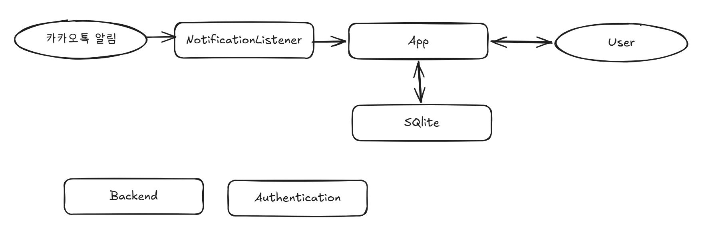
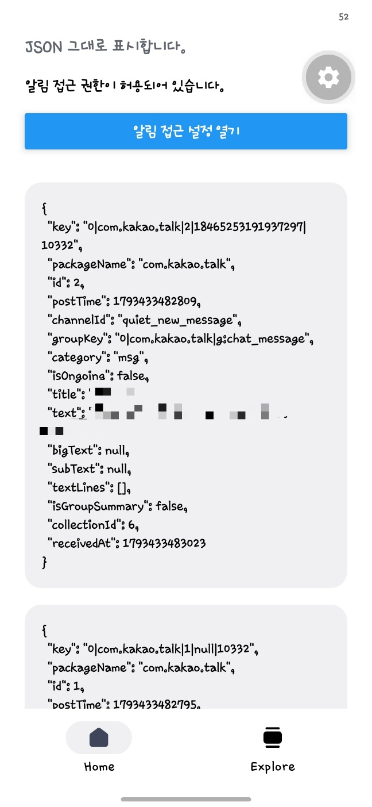

# Overview

### 앱
사용자에게 카카오톡에서 불러온 공지사항을 표시한다.
`NotificationListener`가 수집한 알림을 저장한다.

### DB
카카오톡에서 수집한 알림을 저장한다.

### `NotificationListener`
카카오톡에서 push한 알림을 수집하기 한다.

# Diagram

# Core flow

### 채팅방 등록
- 사용자가 채팅방을 등록한다.
- 추적 채팅방 목록에 해당 내용을 추가한다.
- `NoficationListener`가 push를 수집할 때마다 이 목록을 확인한다.

### 알림 수집 및 정리
- 카카오톡이 알림을 push한다.
- 앱이 `NotificationListener`를 이용해 알림을 수집한다.
- 등록된 공지방의 메시지라면 내용을 DB에 저장한다.
- 사용자에게 내용을 표시한다.

# Data

다량의 데이터를 무결성으로 저장하기 유리한 sqlite를 사용한다.

### chatrooms
| 칼럼명 | 타입 | 설명 | 기타 |
| --- | --- | --- | --- |
| id | INTEGER | PK를 위한 값이다 | PK |
| name | TEXT | 카카오톡 채팅방의 이름 | |

### messages
| 칼럼명 | 타입 | 설명 | 기타 |
| --- | --- | --- | --- |
| id | INTEGER | PK를 위한 값이다 | PK |
| chatroomId | INTEGER | 어떤 방에서 온 값인지 | FK to chatrooms |
| content | TEXT | 메시지 내용 | |
| createdAt | TEXT | 메시지가 온 시각 | |

# Data sources

### 카카오톡 알림
- **방법:** 카카오톡이 push한 알림을 `NoficationListener`를 사용하여 수집한다.
- **실제로 한 번 불러본 결과:** 
- **한계:** 카카오톡이 알림을 push하지 않았다면 수집할 수 없다. (ex. 전원이 꺼져있는 경우, 조용한 채팅방 등) 앱을 설치하기 전 이미 올라온 공지는 수집할 수 없다.
- **언제 가져오나:** 카카오톡이 알림을 push할 떄마다 수집한다.
- **막히면:** *없음.* 이 점이 가장 큰 한계점이다.

# Decisions

### 카카오톡 데이터는 `NotificationListener`로 수집한다.
- **선택지:** 카카오톡 저장소 접근, `NotificationListener`로 모든 알림 수집
- **고른 것:** `NotificationListener`. 카카오톡 저장소는 다른 앱에서 접근할 수 없다.
- **대가:** push가 오지 않으면 수집할 수 없으며, 앱을 설치하기 전 대화 내용은 수집할 수 없다.

### Android 앱만 배포한다.
- `NotificationLister`와 같은 기능은 안드로이드 앱에서만 사용할 수 있다.